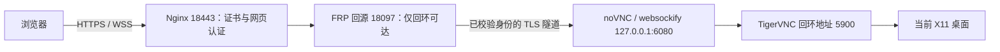

# WebDesktop

通过 noVNC 和 TigerVNC，将已登录的 Linux X11 物理桌面共享到浏览器。
网页操作继续使用桌面上原有的窗口与文件，关闭网页后程序继续运行。
适用于普通浏览器和停车状态下的车机浏览器；Model Y 的兼容性与输入体验需要实车验收。

## 架构与范围



本机脚本负责安装固定版本资源、生成随机凭据及启用两个用户级服务。
云端配置由模板生成，需按[部署指南](deploy/README.md)人工核对并安装；
运行本机安装脚本不会自动开放公网端口或修改现有 FRP。

需要已开机、已登录的桌面。首版不包含 Wayland、重启后未登录接管、音频、USB 转发或高帧率视频。
锁屏与供电策略不由脚本修改，锁屏恢复需单独验证。

## 安装前提

- x86_64 Linux；目标环境为 Ubuntu 22.04 与 GNOME X11。
- Python 3.11 独立环境、用户级 systemd 和可用的图形会话。
- 本机工具：`loginctl`、`systemctl`、`xrandr`、`openssl`；桌面验收另需 `xprop`、`zenity`。
- 公网部署另需已有 Nginx / FRP、可管理的安全组和防火墙、受信任的 HTTPS 证书。

桌面组件固定使用 TigerVNC 1.16.2、noVNC 1.7.0 和 websockify 0.13.0。
下载来源与 SHA-256 固定在 `scripts/fetch_assets.py` 中，第三方二进制不放入仓库。

## 本机安装

以下命令从项目目录执行。首次安装创建独立环境，并禁用用户级 site-packages：

```bash
conda create -n web-desktop python=3.11 -y
conda activate web-desktop
PYTHONNOUSERSITE=1 python -m pip install -r requirements.txt
PYTHONNOUSERSITE=1 python scripts/fetch_assets.py
PYTHONNOUSERSITE=1 python scripts/install_local.py
```

环境已存在时直接激活复用。请保持仓库位置不变；移动目录后需重新运行安装器，
并重启 `web-desktop-vnc`、`web-desktop-web` 用户服务，使启动路径生效。

本机入口为 `http://127.0.0.1:6080/vnc.html?autoconnect=1&resize=scale&reconnect=1&path=websockify`。
此入口只需 VNC 密码；公网入口先经过网页认证，再输入独立 VNC 密码。

## 凭据与私有数据

| 内容 | 路径或默认行为 |
| --- | --- |
| 凭据 | `~/.config/web-desktop/credentials.json`，权限 `600` |
| 网页认证 | `web_username` 默认 `desktop`，`web_password` 随机生成 |
| VNC 认证 | `vnc_password` 随机生成，独立于系统登录密码 |
| 公网地址 | `public_url` 默认留空，也可在生成部署包时传 `--public-ip` |
| 第三方资源 | `~/.local/share/web-desktop/` |
| 部署包、备份和报告 | `~/.local/state/web-desktop/` |

安装器重复执行保留已有凭据。密码不写入 URL、源码或仓库，生成的部署包包含认证哈希，
同样属于私有文件。`.gitignore` 排除凭据、密钥、实际配置、日志和验收产物。
分享代码前仍应检查暂存区，避免把其他位置的私有文件手动加入版本管理。

## 云端配置

将实际公网 IPv4 地址作为参数传入。以下 `203.0.113.10` 为文档示例，不能直接用于部署：

```bash
PYTHONNOUSERSITE=1 python scripts/render_cloud.py --public-ip 203.0.113.10
```

也可以在私有 `credentials.json` 中设置 `public_url` 后省略该参数。
生成目录为 `~/.local/state/web-desktop/cloud-bundle/`，包含 Nginx 配置、网页认证文件及部署元信息。

云端必须先阻断公网直连回源端口 `18097`，再启用桌面 FRP 代理。
所有页面、资源和 WebSocket 都应经过 HTTPS 与独立网页认证，FRP 需验证服务端身份。
完整配置、证书续期、验收和回退见[部署指南](deploy/README.md)。

## 浏览器验收

```bash
PYTHONNOUSERSITE=1 python scripts/verify_browser.py
PYTHONNOUSERSITE=1 python scripts/verify_browser.py --duration 120
```

测试向自身创建的 `WebDesktop` 窗口输入，检查非空桌面画面、大小写和 `Ctrl+A`、
中文软键盘输入、关闭网页后程序保持、重新连接、网关重启后的自动恢复，
以及 980×640 触屏模拟视口。测试会临时打开桌面窗口，并在本地模式重启浏览器网关。

验收程序使用 Playwright Chromium；可运行 `python -m playwright install chromium` 安装，
再通过 `--browser` 指定浏览器可执行文件路径。公网验收使用 `--public --url` 指定已部署的地址。
截图和 JSON 报告仅保存到私有状态目录，不应公开。
实车仍需验证点击、右键、滚动、中文、组合键、缩放、断线重连、锁屏恢复及至少 30 分钟停车使用。

## 检查与回退

```bash
XDG_RUNTIME_DIR=/run/user/$(id -u) systemctl --user status web-desktop-vnc web-desktop-web
XDG_RUNTIME_DIR=/run/user/$(id -u) journalctl --user -u web-desktop-vnc -u web-desktop-web -n 50
ss -lnt '( sport = :5900 or sport = :6080 )'
```

停止并取消登录自启：

```bash
XDG_RUNTIME_DIR=/run/user/$(id -u) systemctl --user disable --now web-desktop-vnc web-desktop-web
```

上述命令只停用本项目的两个服务。云端入口、证书续期和 FRP 代理的回退步骤见部署指南。
